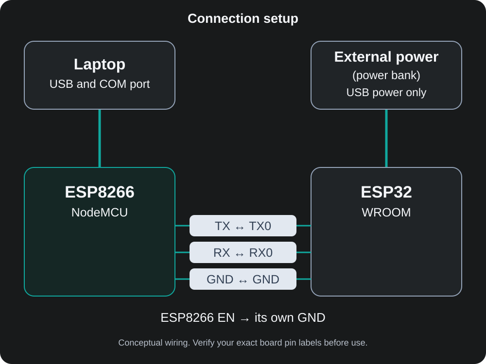

# ESP32 recovery with a borrowed NodeMCU USB-to-UART bridge

My ESP32 would power up—the red LED stayed on—but Windows 11 would not recognize its onboard USB connection. Before calling the board dead, I tried the working USB-to-serial bridge on an ESP8266 ESP-12F NodeMCU I already had.

That got me boot logs, a working download connection, a full flash backup, and finally an Arduino diagnostic sketch running on the ESP32. Seeing the uptime keep increasing was the “wola working” moment.

**Status:** external-UART programming and basic diagnostics work. The original ESP32 onboard USB problem remains unresolved. This repository documents the recovery and diagnosis.

## What I actually confirmed

| Test | Observed result |
| --- | --- |
| ESP32 onboard USB | Not recognized; red power LED on |
| ESP8266 NodeMCU | Appeared on COM9; serial blink/uptime tests worked |
| ESP32 UART0 through NodeMCU | Boot logs and `waiting for download` visible |
| esptool v5.6.0 `read-mac` / `flash-id` | Successful; MAC deliberately omitted here |
| Chip | ESP32-D0WD-V3, revision v3.1, dual core |
| Flash | 4 MiB = 4,194,304 bytes |
| Preservation | Full flash backup saved privately before uploading |
| Arduino IDE 2.3.10 | Upload succeeded using **ESP32 Dev Module**, COM9 |
| Diagnostic sketch | 240 MHz, 2 cores, 4 MiB flash, 4 nearby Wi-Fi networks, increasing uptime |

These tests show that the CPU, UART download path, flash access and basic Wi-Fi scanning worked during this session. They do not establish that every peripheral works or that the board is reliable over long runs. Four networks is an observation, not a required result.

## Hardware and tools

- ESP32 development board containing an ESP32-D0WD-V3 (rev v3.1).
- Working ESP8266 ESP-12F NodeMCU with a USB-to-UART bridge, jumper wires and a USB data cable.
- Windows 11 laptop; NodeMCU enumerated as COM9 in this session.
- External power (power bank) supplying the ESP32 through its USB power input.
- Python with esptool v5.6.0; Arduino IDE 2.3.10 and Espressif's ESP32 board package.

The original ESP32 board-package version was not recorded. COM numbers, bridge chips and board layouts vary; the exact NodeMCU clone schematic has not been identified.

## Wiring: read this before connecting



Disconnect both power sources while changing wiring. I held **the NodeMCU's EN at GND** to disable its ESP8266 processor; its USB bridge still worked. Do not confuse this with holding the ESP32 EN low, which would prevent the target from running.

| NodeMCU connection | ESP32 connection | Purpose |
| --- | --- | --- |
| EN → its own GND | None | Keep ESP8266 disabled |
| Header TX (ESP8266 GPIO1) | TX0 / GPIO1 | ESP32 transmit → bridge receive |
| Header RX (ESP8266 GPIO3) | RX0 / GPIO3 | Bridge transmit → ESP32 receive |
| GND | GND | Common signal reference |
| Laptop USB | None | Powers NodeMCU and provides COM9 |
| None | USB input from external power (power bank) | Powers ESP32 separately |

**Why TX-to-TX and RX-to-RX?** On this type of NodeMCU, header labels describe the ESP8266 UART, not the USB bridge's perspective. The bridge TX feeds the ESP8266 RX header; the bridge RX listens to the ESP8266 TX header. Disabling the ESP8266 lets those nets reach the ESP32. This is still transmitter-to-receiver electrically. A dedicated adapter labeled from the bridge's perspective normally uses adapter TX → ESP32 RX and adapter RX → ESP32 TX.

**Board-specific safety checks:**

- Verify header-to-bridge routing against your own schematic or unpowered continuity checks. Do not copy same-name wiring blindly across clones. The [NodeMCU reference design](https://github.com/nodemcu/nodemcu-devkit-v1.0) is context, not proof of this clone's layout.
- UART signals must be **3.3 V logic**. Do not connect 5 V TTL or RS-232 signals to ESP GPIOs. A USB-powered adapter does not automatically mean its UART voltage is safe.
- Do not join 5 V/VIN or 3V3 rails between these separately powered boards. Share GND only alongside TX/RX. Never short positive supplies together or to GND. Avoid driving UART into an unpowered board, which can back-power it.
- The ESP32's onboard USB-UART bridge may still be electrically attached even when USB enumeration fails. In this setup it may also receive power from the external power connection. It could drive the same ESP32 RX line as the external bridge. Verify isolation/high-impedance behavior before repeating this; if uncertain, isolate the conflicting bridge using the board schematic or use a suitable board/adapter arrangement. Do not force two outputs against one another.
- Keep leads short and stop if a board heats up or power becomes unstable. A red LED only establishes that some power is present.

## Reproduce the diagnosis

### 1. Establish a known-working serial path

Before wiring the ESP32, I uploaded serial blink/uptime tests to the NodeMCU and checked COM9. That established that the laptop, data cable, driver and NodeMCU could communicate. Then I powered down and added the wiring above, including NodeMCU EN → GND. No ESP8266 serial-forwarding firmware is needed: its USB bridge does the work.

### 2. Observe ESP32 boot and enter download mode

Open COM9 at **115200 baud** and reset the ESP32 to inspect its boot log. To enter download mode manually, hold **ESP32 BOOT (GPIO0 low)**, press and release **ESP32 EN/RESET**, then release BOOT. `waiting for download` is expected in that mode. GPIO0 must be released for a normal application boot.

Only TX, RX and GND go to the target here; target DTR/RTS auto-reset is not wired. An uploader saying “Hard resetting via RTS” does not prove that it reset this ESP32. Use the target's buttons when necessary. See Espressif's [boot-mode guide](https://docs.espressif.com/projects/esptool/en/latest/esp32/advanced-topics/boot-mode-selection.html).

### 3. Identify it without writing flash

Close Serial Monitor and other serial terminals first; only one program can own COM9. In PowerShell:

```powershell
py -m pip install esptool==5.6.0
py -m esptool version
py -m esptool --chip esp32 --port COM9 --baud 115200 --before no-reset --after no-reset read-mac
py -m esptool --chip esp32 --port COM9 --baud 115200 --before no-reset --after no-reset flash-id
```

Replace COM9 if Windows assigns another port. Enter download mode before connecting; `no-reset` leaves that responsibility with you. The commands can print the device MAC locally. Do not publish their raw output or unredacted screenshots.

One `read-mac` run reported a 40 MHz crystal. A later `flash-id` run reported an approximately 79.95 MHz measurement normalized to 48 MHz, with a warning. I have not resolved that discrepancy; it is not evidence that the board actually has a 48 MHz crystal. The later application reported **240 MHz CPU clock**, a different measurement. Reset and retest with stable power and short leads before drawing conclusions from the crystal warning.

### 4. Preserve firmware before any upload

Uploading overwrites existing firmware. Keep the backup **outside this repository**, private and with a second copy. The following is a reproduction command for the confirmed 4 MiB flash size, not a claim that the original file has been independently verified here:

```powershell
$backupDir = Join-Path $env:LOCALAPPDATA 'ESP32-Recovery-Private'
New-Item -ItemType Directory -Force -Path $backupDir
$backupFile = Join-Path $backupDir 'esp32-full-flash.bin'
py -m esptool --chip esp32 --port COM9 --baud 115200 --before no-reset --after no-reset read-flash 0x0 0x400000 $backupFile
(Get-Item -LiteralPath $backupFile).Length
Get-FileHash -LiteralPath $backupFile -Algorithm SHA256
```

Require a successful command and **4,194,304 bytes**. For stronger confidence, read a second copy under a different filename before uploading and compare SHA-256 hashes. Size alone is not proof of valid contents. Never overwrite your only backup. A flash image can contain credentials, application data or other private information. It does not back up eFuses and is not a universal restore image for other boards. Do not erase flash, change eFuses, or override security protections as a diagnostic shortcut. See [esptool's read-flash documentation](https://docs.espressif.com/projects/esptool/en/latest/esp32/esptool/basic-commands.html#read-flash-contents-read-flash).

### 5. Upload the diagnostic sketch

1. In Arduino IDE Boards Manager, install **esp32 by Espressif Systems**. If needed, add `https://espressif.github.io/arduino-esp32/package_esp32_index.json` under Additional Boards Manager URLs.
2. Select **ESP32 Dev Module**, COM9, **4 MB flash**, **240 MHz CPU**, and initially **115200 upload speed**. Record the board-package version for future runs.
3. Open [`sketches/esp32_diagnostic/esp32_diagnostic.ino`](sketches/esp32_diagnostic/esp32_diagnostic.ino). This is the original diagnostic sketch used in the recovery session.
4. Verify/compile. With the backup safe, close Serial Monitor, manually enter download mode, then Upload. If connecting stalls, repeat BOOT/RESET while it attempts connection.
5. Release BOOT; press ESP32 EN/RESET to boot the application. Open Serial Monitor at **115200 baud**.

The sketch reports chip model, CPU clock, core count, flash bytes and free heap; scans for Wi-Fi networks once; then prints uptime and heap every two seconds. It prints only the network count, no SSIDs, BSSIDs or MAC address, and contains no Wi-Fi credentials or connection attempt. Wi-Fi scanning uses the [Arduino ESP32 Wi-Fi API](https://docs.espressif.com/projects/arduino-esp32/en/latest/api/wifi.html).

### 6. Check the result

- Expect ESP32-D0WD-V3, 240 MHz, 2 cores and 4,194,304 flash bytes on this configuration.
- Wi-Fi count depends on the environment; zero networks alone does not establish hardware failure. A negative result means the scan failed.
- Watch several uptime lines. Resets to a low value, boot loops or repeated brownout messages require investigation. The original diagnostic run showed uptime 5, 7, 9, 11 and 13 seconds; it is a short test, not a long stability certification. `millis()` wraps after roughly 49.7 days.
- Free heap may fluctuate. These observations do not test all RAM, all flash sectors, Bluetooth, GPIOs or sustained Wi-Fi traffic.

## Troubleshooting

| Symptom | Next check |
| --- | --- |
| COM9 busy / Access denied | Close Serial Monitor, other IDE instances and terminals before esptool/upload. This happened during my session. |
| No COM port from NodeMCU | Check Device Manager, a known data cable, another USB port and the driver matching the actual bridge chip. |
| Power LED but no ESP32 USB device | External UART bypasses that path. Cable, connector, driver and bridge faults remain possibilities, not confirmed causes. |
| No log / esptool cannot connect | Check common GND, correct bridge directions, NodeMCU EN low, target power and manual GPIO0/EN sequence. Check for onboard bridge contention. |
| Gibberish | Use 115200 baud for ESP32 boot/sketch; check leads, power and logic levels. |
| `WiFi.h: No such file or directory` | Select ESP32 Dev Module and install Espressif's ESP32 package. Selecting an ESP8266 or unrelated core is wrong for this sketch; this error occurred in my session. |
| Stuck at `waiting for download` after upload | Release BOOT/GPIO0, then reset the ESP32 to run flash firmware. |
| Brownout, resets or external power shutoff | Check supply/cable quality and external power (power bank) low-load behavior; do not bridge the two positive power rails. |
| Crystal-frequency warning | Re-enter download mode after reset and retest; retain the warning privately and avoid inferring an oscillator specification from it. |

## Evidence and privacy

The connection diagram is the only image included in this repository. It illustrates the reported setup; it is not a measured circuit schematic. Original diagnostic and upload screenshots were reviewed during documentation but are not included. Raw esptool captures with the MAC address and the private flash backup are intentionally excluded. See [`docs/session-notes.md`](docs/session-notes.md) for evidence boundaries. `.gitignore` is a guardrail, not a secret detector; it cannot redact text or remove already tracked data.

## Roadmap

- [x] Confirm a working NodeMCU serial connection.
- [x] Access ESP32 bootloader and identify chip/flash.
- [x] Save a private full flash backup.
- [x] Upload and run basic diagnostics.
- [ ] Diagnose the original onboard USB enumeration failure.
- [ ] Record exact board/bridge models and a checked schematic or wiring photo.
- [ ] Run longer stability tests and verify backup integrity independently.
- [ ] Future project: explore a print server separately from this recovery project.

## License and publishing

MIT was chosen for this small code-and-documentation project so others can reuse and adapt it with attribution and the license notice. It includes no warranty. See [LICENSE](LICENSE). Third-party tool names and linked reference designs retain their own terms.
